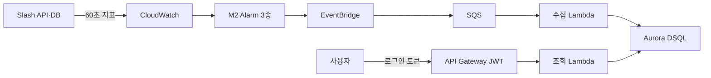

# LambdaOps

LambdaOps는 AWS 서비스의 장애 신호를 받아 **Alarm 에피소드마다 대표 Incident 한 건을 기록**하고, 권한 있는 사용자가 그 근거를 조회할 수 있게 만드는 캡스톤 프로젝트입니다. 장기 목표는 AI 원인 분석과 사용자 승인 후 복구까지 연결하는 것이며, 현재 작업 범위는 **M2 경보와 M3 Incident Core**입니다.

## 현재 구현의 처리 흐름



이 그림은 M3의 연결 구조입니다. Terraform의 기본 저장소는 DSQL이며, 2026-10-28 dev 계정 `642935793048`의 서울 리전에 전용 클러스터·Lambda 2개·큐·권한을 생성했습니다. 후속 단계에서 Cognito 보호 HTTP API를 활성화하고 실제 로그인으로 DSQL 빈 목록 200·무토큰 401·권한 없음 403을 확인했습니다. M2 Alarm 연결과 SQS 소비는 아직 비활성입니다. 실제 적용·연결 확인 결과는 [환경 검증 기록](docs/testing/m2-m3-verification.md), 전체 목표는 [아키텍처](docs/architecture/overview.md)를 따릅니다.

## 현재 진행 상태

| 구간 | 코드·기록된 로컬 검증 | AWS 상태 — 2026-10-28 |
| --- | --- | --- |
| Terraform 상태 저장소 | 암호화·버전 관리 S3와 DynamoDB 잠금 설정 | dev 계정에 생성, 원격 상태 이전 완료 |
| M2 CloudWatch Alarm | 5xx 비율, 평균 API 지연, 평균 DB 쿼리 지연 Terraform 작성·검증 | 대상 Alarm·M2 상태 파일 없음 확인. 실제 AWS 지표·임계값·Alarm 전이 미검증 |
| M3 Incident Core | DSQL 저장·조회, 고정 ID·검색·필터·번호 페이지·건수 구현 | 전용 DSQL·Lambda 2개·큐·권한과 JWT 보호 HTTP API 생성. 빈 목록 조회 검증, EventBridge 미연결·SQS 소비 비활성 |
| 로그인 | 기존 JWT 연결점과 Cognito operator client·읽기 scope 구성 | 시험 사용자 로그인·실제 JWT 발급, 목록 200·무토큰 401·권한 없음 403 확인. 실제 Incident 상세 200은 미검증 |
| 화면 | 승인된 Cloudscape 그래프 시안과 React·TypeScript 프런트 코드가 있습니다. 화면은 예시 Incident·지표로 동작합니다. | 프런트 배포 없음. 실제 JWT·CORS·CloudWatch 시계열 조회 연결 전 |

AWS 상태는 이번 Terraform 적용과 실제 자원 조회를 기준으로 합니다. 인프라 생성, DB 연결, 실제 이벤트·JWT 검증을 구분하며 M3는 In Progress입니다.

## 초기 기술 스택안과 현재 구현

초기 발표 자료의 기술안, 이번에 확정한 목표 아키텍처, 현재 구현을 구분합니다. 아래 초기 발표안의 언어·프레임워크가 모두 최종 그림에서 확정되거나 구현됐다는 뜻은 아닙니다.

| 역할 | 초기 발표안 | 현재 M2·M3 코드와 결정 상태 |
| --- | --- | --- |
| 프런트엔드 | React · TypeScript | Cloudscape 화면 구조와 Recharts 시계열의 예시 화면 구현. 실제 인증·지표 조회 연결과 배포는 남아 있음 |
| 요청·승인 백엔드 | Java · Spring Boot | 목표 그림은 Lambda Backend; 현재 M3 조회는 Python 3.12 Lambda이며 승인·도구 호출 API와 Spring Boot 코드는 없음 |
| AI 에이전트 | Bedrock · Strands · AgentCore | 최종 목표로 선택; M3 범위 밖이며 현재 코드·배포 없음 |
| 이벤트 처리 | EventBridge · SQS · Lambda | 큐·Lambda 배포, 실제 M2 Alarm 연결과 이벤트 전체 경로 검증은 남아 있음 |
| Incident 저장 | Aurora DSQL | **2026-10-28 채택 확정**; 저장·조회 구현 및 전용 클러스터 생성. Terraform은 DSQL 기본 설정 |
| 인프라 | Terraform | 상태 저장소·M3 기반 자원·Cognito 보호 조회 API 적용. M2 연결은 실제 Alarm 준비 후 진행 |
| 외부 도구 연결 | MCP | 최종 목표의 읽기·승인 후 복구 도구; M3 범위 밖이며 구현 전 |

### Incident DB 결정 — 2026-10-28

사용자 결정으로 **Aurora DSQL을 LambdaOps의 Incident DB로 확정**했습니다. 서비스·환경·상태·기간 필터, 검색, 정렬, 페이지 번호 및 정확한 전체 건수 조회 요구사항을 SQL로 설계합니다. 빈번한 조회·저장을 고려하며, 무료 운영이나 DynamoDB보다 낮은 비용을 전제하지 않습니다. 대표 데이터와 호출 빈도로 처리량·저장량을 측정해 비용을 검증합니다.

승인된 [Incident 데이터 모델 설계](https://app.notion.com/p/3df91c6807b18154a44fca6a46ba3eca)의 **3개 테이블·32개 컬럼·10개 인덱스 [생성 SQL](backend/sql/dsql/README.md)**, DSQL 저장·조회 어댑터와 IAM 연결 코드를 작성했습니다. Terraform은 전용 DSQL과 저장·조회 Lambda 권한을 구성하고, [초기화 도구](backend/scripts/dsql-bootstrap.md)는 SQL과 DB 내부 권한을 적용·검사합니다. 로컬 PostgreSQL에서 고정 ID·원자적 저장·동시 수신·조회 일관성을 검증했습니다. EventBridge → SQS → Lambda와 Incident 규칙을 유지하며 Terraform 상태 잠금용 DynamoDB는 별개입니다.

[새 조회 계약](docs/contracts/incident-api.md)은 `page`·`pageSize`, 서비스·환경·상태·기간 필터, 검색·정렬·정확한 건수를 정의합니다. 상세는 이전 ID로 대표를 찾고 요청 ID와 연결 여부를 반환합니다. 조회 주체는 인증된 단일 프로젝트 운영자입니다. 기존 DynamoDB 모드와 프런트는 `limit`·`nextToken`을 유지하므로 공개 API 연결 전 프런트를 새 계약에 맞춰야 합니다. 다음 순서는 **DB·Lambda 연결 확인 → 실제 M2 이벤트·JWT 연결 → 프런트 연동·비용 검증**입니다.

선택 이유와 구현 전 확인할 조건은 [Incident DB 결정 기록](docs/decisions/0001-incident-db.md)에 정리합니다. 기존 [Incident 데이터 모델 설계](https://app.notion.com/p/3df91c6807b18154a44fca6a46ba3eca), [M3 Core](https://app.notion.com/p/3ea91c6807b1818a988ddba8c22356e6), [개발 로드맵](https://app.notion.com/p/3ea91c6807b181958727e27c53cf8b0c)은 승인된 논리 설계와 작업 상태를 연결합니다. Spring Boot·Agent 관련 선택은 이번 DB 결정과 별개입니다. Cognito의 생성·검증 상태는 위 표와 환경 검증 기록을 따릅니다.

현재 M3에서는 **Alarm 에피소드당 대표 Incident 한 건**을 만듭니다. DSQL 목표에서 같은 에피소드의 기존 ID를 보존하는 연결용 행은 목록·검색·전체 건수에서 제외합니다. 동일 이벤트는 계정·리전·Alarm ARN·상태·전환 시각으로 중복을 판별합니다. `OK`는 해당 Alarm 에피소드의 종료 시각을 기록하지만 서비스 전체 복구나 Incident `Resolved`를 뜻하지 않습니다. `INSUFFICIENT_DATA`는 종료로 처리하지 않으며, 오래된 전환 이벤트가 최신 상태를 덮어쓰지 못하도록 합니다. 자세한 규칙은 [Alarm 이벤트 계약](docs/contracts/alarm-event.md)과 [백엔드 설명](backend/README.md)에 있습니다.

## 저장소 구성

| 위치 | 역할 |
| --- | --- |
| [`AGENTS.md`](AGENTS.md) | 저장소 공통 에이전트 작업 규칙 |
| [`docs/architecture/`](docs/architecture/) | 확정 목표와 현재 구현의 차이 |
| [`docs/contracts/`](docs/contracts/) | 확정된 Alarm·Incident 계약과 별도로 표시한 M4·M5 및 실측 지표 API 제안 |
| [`docs/decisions/`](docs/decisions/) | 승인된 기술 결정과 전환 조건 |
| [`docs/testing/`](docs/testing/) | 코드·AWS 환경 검증 기준과 증거 구분 |
| [`backend/lambdaops_m3/`](backend/lambdaops_m3/) | 이벤트 계약, Incident 처리·저장, 수집·조회 Lambda |
| [`backend/tests/`](backend/tests/) | ALARM·OK·INSUFFICIENT_DATA·중복·역순 이벤트 fixture와 테스트 |
| [`backend/sql/dsql/`](backend/sql/dsql/) | 승인된 DSQL 테이블·인덱스 생성 SQL, 설치 확인 SQL과 실행 안내 |
| [`backend/tests_sql/`](backend/tests_sql/) | 별도 로컬 PostgreSQL에서 실행하는 SQL 제약조건 테스트 |
| [`backend/tests_dsql/`](backend/tests_dsql/) | SQL 어댑터 저장·조회·동시 수신·롤백 통합 테스트 |
| [`backend/scripts/`](backend/scripts/) | Python 3.12 Lambda ZIP 생성, DSQL 초기화·권한 검사 |
| [`frontend/`](frontend/) | 승인된 Pen 시안을 옮긴 React·TypeScript 화면, 예시 지표와 M3 조회 클라이언트 |
| [`infra/modules/m2-alarms/`](infra/modules/m2-alarms/) | 재사용 가능한 M2 Alarm Terraform 모듈 |
| [`infra/modules/m3-core/`](infra/modules/m3-core/) | DSQL·IAM·EventBridge·SQS·Lambda·API Terraform 모듈 |
| [`infra/environments/dev/`](infra/environments/dev/) | 상태 저장소 `bootstrap/`, M2 `m2/`, M3 `m3/` 배포 루트 |

## 로컬에서 확인하기

저장소 루트에서 다음 명령으로 테스트할 수 있습니다. Lambda 배포 런타임은 Python 3.12이며, 이 로컬 테스트 명령은 AWS 자원을 만들지 않습니다.

```bash
cd backend
python3.12 -m venv .venv
source .venv/bin/activate
python -m pip install -r requirements.txt
python -m unittest discover -s tests -v
```

`main` 대상 PR과 `main` push에서 [CI](.github/workflows/ci.yml)가 Python 3.12 단위 테스트, 일회용 PostgreSQL의 제약조건·어댑터 통합 테스트, Terraform 검사를 실행합니다. DSQL 인프라 구현 커밋 `3627cbb`의 [GitHub CI](https://github.com/YeonWoojuice/LambdaOps/actions/runs/40645586025)에서 백엔드·프런트·Terraform 검사가 모두 통과했습니다. CI는 AWS 자격 증명이나 `terraform plan/apply`를 사용하지 않습니다. 작업별 브랜치·분리된 `git worktree`·PR 검토와 병합·AWS 배포의 별도 승인은 [작업 규칙](AGENTS.md)을 따릅니다.

프런트는 `frontend/`에서 `npm ci`, `npm run typecheck`, `npm test`, `npm run build`로 확인합니다. CI에는 이 검사도 포함하며 프런트 배포는 하지 않습니다. 화면의 그래프는 CloudWatch 실측이 아닌 **예시 데이터**입니다. 현행 M3 API에는 Incident 목록·상세만 있어 실제 그래프를 위해서는 인증된 지표 조회 경로가 추가로 필요합니다. [프런트 실행과 데이터 경계](frontend/README.md).

배포 ZIP 제작은 [패키징 안내](backend/scripts/README.md), Terraform 준비·검증·적용 순서는 [dev 배포 안내](infra/environments/dev/README.md)를 따릅니다. AWS 자격 증명, Terraform 상태 파일, 토큰은 Git에 올리지 않습니다.

Slash 시험 대상의 기존 Fargate 구성과 EC2 대안, 서울 리전 예상 비용은 [배포 방식·비용 검토](infra/environments/dev/README.md#slash-시험-환경의-배포-방식과-비용--2026-10-28)에 정리했습니다. 이 검토로 Slash를 배포하거나 기존 구조를 변경하지는 않았습니다.

## 다음 검증 순서

M3 기반 자원과 실제 이벤트·사용자 조회 연결을 단계별로 검증합니다. M2를 기다리는 동안에도 DSQL·Lambda 연결과 fixture를 검증할 수 있습니다. 프런트 예시 화면의 빌드 성공은 AWS·인증·실측 지표 연결을 뜻하지 않습니다. 검증 항목과 증거 기준은 [M2·M3 검증 계획](docs/testing/m2-m3-verification.md)에 정리합니다.

1. Slash API·DB의 AWS 시험 실행 방식을 정하고 `LambdaOps/Slash` 집계 지표 5종과 진단 Gauge 1종이 60초마다 발행되는지 확인합니다.
2. 실제 지표와 트래픽으로 M2의 임계값·최소 요청 수를 정한 뒤 Alarm 3개를 적용하고 `ALARM → OK`를 확인합니다.
3. 준비된 M2 출력을 Terraform에 연결한 뒤 fixture 재생으로 중복·역순·실패·OK 처리와 실제 장애 전체 경로를 검증합니다.
4. 검증된 Cognito 로그인·조회 API로 실제 Incident 상세 200을 확인하고, 프런트의 조회 계약과 인증 연결을 전환합니다.

M2·M3의 AWS 검증이 끝나기 전에는 마일스톤을 완료로 표시하지 않습니다. AI Agent, MCP 분석, Rollback, 서비스 단위 Alarm 병합은 이번 Core 범위에 포함되지 않습니다. 프런트 코드는 별도 예시 화면 단계이며 M3 Core의 실환경 Exit Criteria 완료를 뜻하지 않습니다.

확정 아키텍처·계약·기술 결정은 저장소의 `docs/`에서 코드와 함께 버전 관리합니다. 작업·마일스톤·초안·검증 상태는 기존 [LambdaOps 개발 허브](https://app.notion.com/p/3df91c6807b1813daacceeb3d42a93dd)에서 관리하고 확정 문서로 연결합니다.

실측 그래프의 [지표 조회 API](docs/contracts/incident-metrics-api.md), [M4 RCA](docs/contracts/rca-analysis.md), [M5 승인·실행](docs/contracts/recovery-approval.md), [M4·M5 검증 게이트](docs/testing/m4-m5-verification.md)는 **사용자 검토 전 설계 초안**입니다. `lambdaops-ui.pen`의 신규 화면도 설계 초안이며, 이를 실제 API·Agent·복구 기능의 구현이나 AWS 검증 결과로 간주하지 않습니다.
