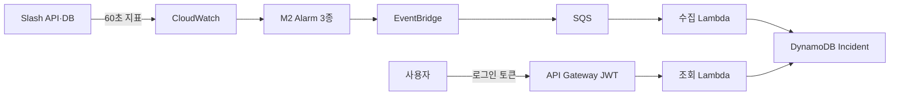

# LambdaOps

LambdaOps는 AWS 서비스의 장애 신호를 받아 **Alarm 에피소드마다 대표 Incident 한 건을 기록**하고, 권한 있는 사용자가 그 근거를 조회할 수 있게 만드는 캡스톤 프로젝트입니다. 장기 목표는 AI 원인 분석과 사용자 승인 후 복구까지 연결하는 것이며, 현재 작업 범위는 **M2 경보와 M3 Incident Core**입니다.

## 현재 구현의 처리 흐름



이 그림은 현재 Terraform의 기본 DynamoDB 경로입니다. 백엔드에는 `INCIDENT_STORE=dsql`로 선택하는 DSQL 저장·조회 코드도 있습니다. 2026-10-14 기록에는 M2 Alarm·M3 자원이 미배포이고 Slash는 로컬 실행 중이라고 적혀 있습니다. 현재 AWS 상태는 별도 확인이 필요합니다. [현재·목표 아키텍처](docs/architecture/overview.md).

## 현재 진행 상태

| 구간 | 코드·기록된 로컬 검증 | 마지막 문서의 AWS 상태 |
| --- | --- | --- |
| Terraform 상태 저장소 | 암호화·버전 관리 S3와 DynamoDB 잠금 설정 | dev 계정에 생성, 원격 상태 이전 완료 |
| M2 CloudWatch Alarm | 5xx 비율, 평균 API 지연, 평균 DB 쿼리 지연 Terraform 작성·검증 | 2026-10-14 기록상 미배포; LambdaOps 대상 AWS 지표·임계값·Alarm 전이 미검증 |
| M3 Incident Core | DynamoDB 호환 경로와 DSQL 저장·조회 구현; 고정 ID·검색·필터·번호 페이지·건수를 로컬 SQL로 검증 | EventBridge·SQS·Lambda·Incident DB·API 미배포 |
| 로그인 | OIDC/JWT 연결점 구현, Cognito 설정 방법 문서화 | Cognito는 검토 중이며 미생성 |
| 화면 | 승인된 Cloudscape 그래프 시안과 React·TypeScript 프런트 코드가 있습니다. 화면은 예시 Incident·지표로 동작합니다. | 프런트 배포 없음. 실제 JWT·CORS·CloudWatch 시계열 조회 연결 전 |

AWS 상태 열은 기존 문서의 기록이며, 이번 문서 정리에서 AWS 계정을 직접 조회하지 않았습니다. CI 통과를 배포 검증으로 표시하지 않습니다.

## 초기 기술 스택안과 현재 구현

초기 발표 자료의 기술안, 이번에 확정한 목표 아키텍처, 현재 구현을 구분합니다. 아래 초기 발표안의 언어·프레임워크가 모두 최종 그림에서 확정되거나 구현됐다는 뜻은 아닙니다.

| 역할 | 초기 발표안 | 현재 M2·M3 코드와 결정 상태 |
| --- | --- | --- |
| 프런트엔드 | React · TypeScript | Cloudscape 화면 구조와 Recharts 시계열의 예시 화면 구현. 실제 인증·지표 조회 연결과 배포는 남아 있음 |
| 요청·승인 백엔드 | Java · Spring Boot | 목표 그림은 Lambda Backend; 현재 M3 조회는 Python 3.12 Lambda이며 승인·도구 호출 API와 Spring Boot 코드는 없음 |
| AI 에이전트 | Bedrock · Strands · AgentCore | 최종 목표로 선택; M3 범위 밖이며 현재 코드·배포 없음 |
| 이벤트 처리 | EventBridge · SQS · Lambda | 동일한 경로의 Terraform과 수집 Lambda 코드 작성; AWS 배포 검증 전 |
| Incident 저장 | Aurora DSQL | **2026-10-28 Aurora DSQL 채택 확정**; DSQL 어댑터 로컬 구현·검증. 기본 설정·Terraform은 DynamoDB이며 AWS 전환 전 |
| 인프라 | Terraform | 상태 저장소 적용 완료; M2·M3 자원은 미배포 |
| 외부 도구 연결 | MCP | 최종 목표의 읽기·승인 후 복구 도구; M3 범위 밖이며 구현 전 |

### Incident DB 결정 — 2026-10-28

사용자 결정으로 **Aurora DSQL을 LambdaOps의 Incident DB로 확정**했습니다. 서비스·환경·상태·기간 필터, 검색, 정렬, 페이지 번호 및 정확한 전체 건수 조회 요구사항을 SQL로 설계합니다. 빈번한 조회·저장을 고려하며, 무료 운영이나 DynamoDB보다 낮은 비용을 전제하지 않습니다. 대표 데이터와 호출 빈도로 처리량·저장량을 측정해 비용을 검증합니다.

현재 기본 설정과 Terraform은 DynamoDB를 사용합니다. 승인된 [Incident 데이터 모델 설계](https://app.notion.com/p/3df91c6807b18154a44fca6a46ba3eca)의 **3개 테이블·32개 컬럼·10개 인덱스 [생성 SQL](backend/sql/dsql/README.md)**에 이어 DSQL 저장·조회 어댑터와 IAM 연결 코드를 작성했습니다. 로컬 PostgreSQL에서 고정 ID·원자적 저장·동시 수신·조회 일관성을 검증했습니다. 실제 DSQL 적용·IAM 역할 연결·Terraform 전환 및 AWS 검증은 남아 있습니다. EventBridge → SQS → Lambda와 Incident 규칙을 유지하며 Terraform 상태 잠금용 DynamoDB는 별개입니다.

[새 조회 계약](docs/contracts/incident-api.md)은 `page`·`pageSize`, 서비스·환경·상태·기간 필터, 검색·정렬·정확한 건수를 정의합니다. 상세는 이전 ID로 대표를 찾고 요청 ID와 연결 여부를 반환합니다. 조회 주체는 인증된 단일 프로젝트 운영자입니다. 기존 DynamoDB 모드와 프런트는 `limit`·`nextToken`을 유지하므로 배포 전 함께 전환해야 합니다. 다음 순서는 **Terraform·IAM·DB 권한 구성 → DSQL 스키마 적용·Lambda 연결 → 실제 JWT·이벤트·비용 검증**입니다.

선택 이유와 구현 전 확인할 조건은 [Incident DB 결정 기록](docs/decisions/0001-incident-db.md)에 정리합니다. 기존 [Incident 데이터 모델 설계](https://app.notion.com/p/3df91c6807b18154a44fca6a46ba3eca), [M3 Core](https://app.notion.com/p/3ea91c6807b1818a988ddba8c22356e6), [개발 로드맵](https://app.notion.com/p/3ea91c6807b181958727e27c53cf8b0c)은 승인된 논리 설계와 작업 상태를 연결합니다. Spring Boot·Cognito·Agent 관련 선택은 이번 DB 결정과 별개입니다.

현재 M3에서는 **Alarm 에피소드당 대표 Incident 한 건**을 만듭니다. DSQL 목표에서 같은 에피소드의 기존 ID를 보존하는 연결용 행은 목록·검색·전체 건수에서 제외합니다. 동일 이벤트는 계정·리전·Alarm ARN·상태·전환 시각으로 중복을 판별합니다. `OK`는 해당 Alarm 에피소드의 종료 시각을 기록하지만 서비스 전체 복구나 Incident `Resolved`를 뜻하지 않습니다. `INSUFFICIENT_DATA`는 종료로 처리하지 않으며, 오래된 전환 이벤트가 최신 상태를 덮어쓰지 못하도록 합니다. 자세한 규칙은 [Alarm 이벤트 계약](docs/contracts/alarm-event.md)과 [백엔드 설명](backend/README.md)에 있습니다.

## 저장소 구성

| 위치 | 역할 |
| --- | --- |
| [`AGENTS.md`](AGENTS.md) | 저장소 공통 에이전트 작업 규칙 |
| [`docs/architecture/`](docs/architecture/) | 확정 목표와 현재 구현의 차이 |
| [`docs/contracts/`](docs/contracts/) | Alarm 이벤트와 Incident 조회의 확정 계약 |
| [`docs/decisions/`](docs/decisions/) | 승인된 기술 결정과 전환 조건 |
| [`docs/testing/`](docs/testing/) | 코드·AWS 환경 검증 기준과 증거 구분 |
| [`backend/lambdaops_m3/`](backend/lambdaops_m3/) | 이벤트 계약, Incident 처리·저장, 수집·조회 Lambda |
| [`backend/tests/`](backend/tests/) | ALARM·OK·INSUFFICIENT_DATA·중복·역순 이벤트 fixture와 테스트 |
| [`backend/sql/dsql/`](backend/sql/dsql/) | 승인된 DSQL 테이블·인덱스 생성 SQL, 설치 확인 SQL과 실행 안내 |
| [`backend/tests_sql/`](backend/tests_sql/) | 별도 로컬 PostgreSQL에서 실행하는 SQL 제약조건 테스트 |
| [`backend/tests_dsql/`](backend/tests_dsql/) | SQL 어댑터 저장·조회·동시 수신·롤백 통합 테스트 |
| [`backend/scripts/`](backend/scripts/) | Python 3.12 Lambda 배포 ZIP 생성 |
| [`frontend/`](frontend/) | 승인된 Pen 시안을 옮긴 React·TypeScript 화면, 예시 지표와 M3 조회 클라이언트 |
| [`infra/modules/m2-alarms/`](infra/modules/m2-alarms/) | 재사용 가능한 M2 Alarm Terraform 모듈 |
| [`infra/modules/m3-core/`](infra/modules/m3-core/) | EventBridge·SQS·Lambda·DynamoDB·API Terraform 모듈 |
| [`infra/environments/dev/`](infra/environments/dev/) | 상태 저장소 `bootstrap/`, M2 `m2/`, M3 `m3/` 배포 루트 |

## 로컬에서 확인하기

저장소 루트에서 다음 명령으로 테스트할 수 있습니다. Lambda 배포 런타임은 Python 3.12이며, 이 로컬 테스트 명령은 AWS 자원을 만들지 않습니다.

```bash
cd backend
python3.12 -m venv .venv
source .venv/bin/activate
python -m pip install -r requirements.txt
python -m unittest discover -s tests -v
```

`main`에 코드를 올리면 [CI](.github/workflows/ci.yml)가 Python 3.12 단위 테스트, 일회용 PostgreSQL의 제약조건·어댑터 통합 테스트, Terraform 검사를 실행하도록 구성했습니다. 이번 변경의 원격 CI 실행은 아직 확인하지 않았습니다. CI는 AWS 자격 증명이나 `terraform plan/apply`를 사용하지 않습니다.

프런트는 `frontend/`에서 `npm ci`, `npm run typecheck`, `npm test`, `npm run build`로 확인합니다. CI에는 이 검사도 포함하며 프런트 배포는 하지 않습니다. 화면의 그래프는 CloudWatch 실측이 아닌 **예시 데이터**입니다. 현행 M3 API에는 Incident 목록·상세만 있어 실제 그래프를 위해서는 인증된 지표 조회 경로가 추가로 필요합니다. [프런트 실행과 데이터 경계](frontend/README.md).

배포 ZIP 제작은 [패키징 안내](backend/scripts/README.md), Terraform 준비·검증·적용 순서는 [dev 배포 안내](infra/environments/dev/README.md)를 따릅니다. AWS 자격 증명, Terraform 상태 파일, 토큰은 Git에 올리지 않습니다.

## 다음 검증 순서

M3 배포 전에 위 DSQL 전환과 fixture 기반 검증을 완료합니다. M2 실제 배포 검증과 M3 코드 전환은 별도 작업이며, M2를 기다리는 동안에도 fixture로 M3를 검증할 수 있습니다. 프런트 예시 화면의 빌드 성공은 AWS·인증·실측 지표 연결을 뜻하지 않습니다. 검증 항목과 증거 기준은 [M2·M3 검증 계획](docs/testing/m2-m3-verification.md)에 정리합니다.

1. Slash API·DB의 AWS 시험 실행 방식을 정하고 `LambdaOps/Slash` 지표 5종이 60초마다 발행되는지 확인합니다.
2. 실제 지표와 트래픽으로 M2의 임계값·최소 요청 수를 정한 뒤 Alarm 3개를 적용하고 `ALARM → OK`를 확인합니다.
3. Cognito를 사용할지와 Incident를 읽을 사용자 범위를 정하고, 실제 발급된 읽기 권한 토큰을 준비합니다.
4. M3를 적용한 뒤 이벤트 fixture 재생으로 중복·역순·실패·OK 처리를 확인하고, 인증된 Incident 상세 조회와 실제 장애 전체 경로를 검증합니다.

M2·M3의 AWS 검증이 끝나기 전에는 마일스톤을 완료로 표시하지 않습니다. AI Agent, MCP 분석, Rollback, 서비스 단위 Alarm 병합은 이번 Core 범위에 포함되지 않습니다. 프런트 코드는 별도 예시 화면 단계이며 M3 Core의 실환경 Exit Criteria 완료를 뜻하지 않습니다.

확정 아키텍처·계약·기술 결정은 저장소의 `docs/`에서 코드와 함께 버전 관리합니다. 작업·마일스톤·초안·검증 상태는 기존 [LambdaOps 개발 허브](https://app.notion.com/p/3df91c6807b1813daacceeb3d42a93dd)에서 관리하고 확정 문서로 연결합니다.
