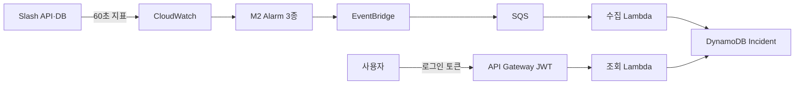

# LambdaOps

LambdaOps는 AWS 서비스의 장애 신호를 받아 **Alarm 에피소드마다 Incident 한 건을 기록**하고, 권한 있는 사용자가 그 근거를 조회할 수 있게 만드는 캡스톤 프로젝트입니다. 장기 목표는 AI 원인 분석과 사용자 승인 후 복구까지 연결하는 것이며, 현재 작업 범위는 **M2 경보와 M3 Incident Core**입니다.

## 처리 흐름



이 그림은 현재 M2·M3 코드가 구성하려는 경로입니다. **2026-10-14 기준 M2 Alarm과 M3 자원은 AWS에 아직 배포되지 않았습니다.** Slash API·DB도 현재 로컬에서만 실행 중입니다.

## 현재 진행 상태

| 구간 | 구현·로컬 검증 | 실제 AWS 상태 |
| --- | --- | --- |
| Terraform 상태 저장소 | 암호화·버전 관리 S3와 DynamoDB 잠금 설정 | dev 계정에 생성, 원격 상태 이전 완료 |
| M2 CloudWatch Alarm | 5xx 비율, 평균 API 지연, 평균 DB 쿼리 지연 Terraform 작성·검증 | 지표 실측과 기준값 결정 전이라 미배포 |
| M3 Incident Core | 이벤트 처리, DynamoDB 저장, 인증된 목록·상세 조회 구현; 로컬 테스트 **46개 통과** | EventBridge·SQS·Lambda·Incident DB·API 미배포 |
| 로그인 | OIDC/JWT 연결점 구현, Cognito 설정 방법 문서화 | Cognito는 검토 중이며 미생성 |
| 화면 | Pen 와이어프레임 검토 후 구현 예정 | 프런트엔드 코드 없음 |

## 초기 기술 스택안과 현재 구현

초기 발표 자료에는 아래 기술을 역할별 **구현 예정안**으로 제시했습니다. 현재 코드가 같은 기술을 모두 채택하거나 완성했다는 뜻은 아닙니다.

| 역할 | 초기 발표안 | 현재 M2·M3 코드와 결정 상태 |
| --- | --- | --- |
| 프런트엔드 | React · TypeScript | Pen 검토 단계; 프런트엔드 코드 없음 |
| 요청·승인 백엔드 | Java · Spring Boot | M3 조회는 Python 3.12 Lambda로 구현; 승인·도구 호출 API와 Spring Boot 코드는 없음 |
| AI 에이전트 | Bedrock · Strands · AgentCore | M3 범위 밖; 채택·구현 전 |
| 이벤트 처리 | EventBridge · SQS · Lambda | 동일한 경로의 Terraform과 수집 Lambda 코드 작성; AWS 배포 검증 전 |
| Incident 저장 | Aurora DSQL | M3에는 DynamoDB 단일 테이블 구현; 최종 저장소 결정은 별도 확인 필요 |
| 인프라 | Terraform | 상태 저장소 적용 완료; M2·M3 자원은 미배포 |
| 외부 도구 연결 | MCP | M3 범위 밖; 구현 전 |

[개발 로드맵](https://app.notion.com/p/3ea91c6807b181958727e27c53cf8b0c)은 발표 자료의 AgentCore·Strands·Aurora DSQL을 현재 채택된 구현 기술로 보지 않습니다. [Incident 데이터 모델 설계](https://app.notion.com/p/3df91c6807b18154a44fca6a46ba3eca)는 Aurora DSQL을 후보로 두고, DynamoDB를 **M3의 현재 구현**으로 기록합니다. 위 표는 기술을 폐기하거나 최종 확정하는 결정이 아닙니다.

M3에서는 **Alarm 에피소드당 Incident 한 건**을 만듭니다. 동일 이벤트는 계정·리전·Alarm ARN·상태·전환 시각으로 중복을 판별합니다. `OK`는 해당 Alarm 에피소드의 종료 시각을 기록하지만 서비스 전체 복구나 Incident `Resolved`를 뜻하지 않습니다. `INSUFFICIENT_DATA`는 종료로 처리하지 않으며, 오래된 전환 이벤트가 최신 상태를 덮어쓰지 못하도록 합니다. 자세한 규칙은 [백엔드 설명](backend/README.md)에 있습니다.

## 저장소 구성

| 위치 | 역할 |
| --- | --- |
| [`backend/lambdaops_m3/`](backend/lambdaops_m3/) | 이벤트 계약, Incident 처리·저장, 수집·조회 Lambda |
| [`backend/tests/`](backend/tests/) | ALARM·OK·INSUFFICIENT_DATA·중복·역순 이벤트 fixture와 테스트 |
| [`backend/scripts/`](backend/scripts/) | Python 3.12 Lambda 배포 ZIP 생성 |
| [`infra/modules/m2-alarms/`](infra/modules/m2-alarms/) | 재사용 가능한 M2 Alarm Terraform 모듈 |
| [`infra/modules/m3-core/`](infra/modules/m3-core/) | EventBridge·SQS·Lambda·DynamoDB·API Terraform 모듈 |
| [`infra/environments/dev/`](infra/environments/dev/) | 상태 저장소 `bootstrap/`, M2 `m2/`, M3 `m3/` 배포 루트 |

## 로컬에서 확인하기

저장소 루트에서 다음 명령으로 테스트할 수 있습니다. Lambda 배포 런타임은 Python 3.12이며, 이 로컬 테스트 명령은 AWS 자원을 만들지 않습니다.

```bash
cd backend
python3 -m unittest discover -s tests -v
```

`main`에 코드를 올리면 [CI](.github/workflows/ci.yml)가 Python 3.12 테스트와 Terraform 형식·설정 검사를 자동 실행합니다. CI는 AWS 자격 증명을 사용하거나 `terraform plan/apply`를 실행하지 않으므로 AWS 자원을 생성하지 않습니다. GitHub Actions 화면에서 수동으로 다시 실행할 수도 있습니다.

배포 ZIP 제작은 [패키징 안내](backend/scripts/README.md), Terraform 준비·검증·적용 순서는 [dev 배포 안내](infra/environments/dev/README.md)를 따릅니다. AWS 자격 증명, Terraform 상태 파일, 토큰은 Git에 올리지 않습니다.

## 다음 검증 순서

1. Slash API·DB의 AWS 시험 실행 방식을 정하고 `LambdaOps/Slash` 지표 5종이 60초마다 발행되는지 확인합니다.
2. 실제 지표와 트래픽으로 M2의 임계값·최소 요청 수를 정한 뒤 Alarm 3개를 적용하고 `ALARM → OK`를 확인합니다.
3. Cognito를 사용할지와 Incident를 읽을 사용자 범위를 정하고, 실제 발급된 읽기 권한 토큰을 준비합니다.
4. M3를 적용한 뒤 이벤트 fixture 재생으로 중복·역순·실패·OK 처리를 확인하고, 인증된 Incident 상세 조회와 실제 장애 전체 경로를 검증합니다.

M2·M3의 AWS 검증이 끝나기 전에는 마일스톤을 완료로 표시하지 않습니다. AI Agent, MCP 분석, Rollback, 서비스 단위 Alarm 병합, 프런트엔드 구현은 이번 Core 범위에 포함되지 않습니다.

설계와 마일스톤의 기준 문서는 [LambdaOps 개발 허브](https://app.notion.com/p/3df91c6807b1813daacceeb3d42a93dd)입니다.
