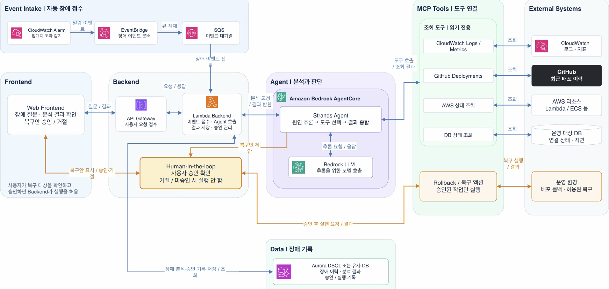

# LambdaOps 아키텍처: 최종 목표와 현재 구현

확인일: 2026-10-28. 아래 그림은 사용자가 확정한 **최종 목표**입니다. 모든 연결이 이미 구현·배포됐다는 뜻은 아닙니다.

## 목표 흐름

1. **자동 장애 접수:** CloudWatch Alarm → EventBridge → SQS → Lambda Backend. SQS가 상태 변경 이벤트를 잠시 쌓아 Lambda에 전달합니다. 이벤트의 도착 순서를 상태 전환 순서로 가정하지 않습니다.
2. **사용자 화면:** Web Frontend ↔ API Gateway ↔ Lambda Backend. 사용자는 장애·분석 결과를 보고 복구 제안을 승인하거나 거절합니다.
3. **원인 분석:** Backend가 Amazon Bedrock AgentCore에서 실행되는 Strands Agent에 분석을 요청합니다. Agent는 추론에 Amazon Bedrock 모델 API를 호출하고, MCP **읽기 도구**로 CloudWatch Logs/Metrics, GitHub Deployments, AWS 상태, 운영 대상 DB를 조사합니다.
4. **복구 실행:** 승인된 작업만 MCP Action Tool로 실행합니다. 구현 시 Backend는 인증된 사용자의 승인이 특정 복구 대상·작업에 유효한지 다시 확인해야 합니다. 화면의 승인 표시만으로 실행을 허용하지 않습니다. 거절 또는 미승인이면 실행하지 않습니다.
5. **기록:** Incident, 분석, 승인, 실행 이력을 Incident DB에 저장합니다. 2026-10-28 사용자 결정은 Aurora DSQL 선택입니다. 그림에 대체 DB 가능성이 표시돼 있어도 대체 DB가 이미 구현됐다는 뜻은 아닙니다. [DB 결정](../decisions/0001-incident-db.md).

## M4·M5 설계 후보 — M3 완료 후 구현

[기존 M4 계획](https://app.notion.com/p/3ea91c6807b18121b17cf3b7543f23d3)에 따라 관측 대상 하나·장애 시나리오 하나로 시작합니다. 먼저 AI 없이 같은 대상의 근거를 수집·구조화하는 흐름을 확인한 뒤 AgentCore·Strands·Bedrock 분석을 연결합니다. `get_metrics`, `search_logs`, `get_deployments`, `get_resource_status`는 읽기 전용 도구 후보이며 아직 구현된 API가 아닙니다. 각 도구의 허용 대상, 계정·리전·서비스·환경·UTC 시간 범위, 조회량·실행 횟수·시간 제한과 실패 처리를 착수 시 확정합니다.

Metric은 집계, Log는 사건 기록, Trace는 실제 계측된 요청 흐름으로 구분합니다. 기존 필드와 공통 식별값의 [매핑 기준](https://github.com/YeonWoojuice/slash-personal/blob/main/docs/observability/M2_CLOUDWATCH.md#근거-연결을-위한-식별-매핑--설계-기준)을 사용하며 요청 ID·Trace ID를 CloudWatch Metric Dimension에 추가하지 않습니다. 배포 버전과 Trace는 실제로 확보한 경우에만 근거로 연결합니다. 보고서는 **관측된 사실·원인 가설·반대 근거·미확인 항목·권장 다음 조회**를 구분하고 원본 위치·시각·조회 조건을 남깁니다. 도구 호출 성공과 원인 판단 정확도는 따로 평가합니다. 현재 DSQL 세 테이블에 원본 로그를 추가 저장하지 않습니다.

[기존 M5 계획](https://app.notion.com/p/3ea91c6807b18115904cf3fe839fae76)은 **권장 → 승인 → 실행 → 확인** 순서입니다. 서버가 실제 JWT·사용자 권한·승인 대상·작업·만료·중복 사용 여부를 검증하고, 읽기 권한과 변경 권한을 분리합니다. 승인·실행·사후 확인 근거를 감사 기록으로 남기며 실행 API 성공이나 Alarm OK만으로 복구를 선언하지 않습니다. 첫 복구 동작과 정상 판정 기준은 M4 이후 확정합니다. 이 절은 설계 후보 요약이며 M4·M5는 Not Started입니다.

## 현재 저장소에서 확인한 범위

| 구간 | 코드·문서 근거 | 환경 검증 상태 |
| --- | --- | --- |
| M1 Slash 관측 시험 | [M1 기록](https://app.notion.com/p/3ea91c6807b1819786b6e515e3a2a6f7)에 로컬 실측이 있습니다. Slash 실행 코드는 이 저장소에 없습니다. | Slash의 현재 AWS 실행 상태는 이번 조사에서 확인하지 못했습니다. |
| M2 Alarm | [Terraform Alarm 3종](../../infra/modules/m2-alarms/main.tf)은 API 5xx 비율, API 평균 지연, DB 쿼리 평균 지연을 다룹니다. | dev 계정의 대상 Alarm과 M2 상태 파일이 아직 없음을 확인했습니다. 실제 지표·임계값·전이 검증 전이며 [M2](https://app.notion.com/p/3ea91c6807b181e5a12cf833bac129d8)는 In Progress입니다. |
| M3 접수·Incident | [Python Backend](../../backend/lambdaops_m3/)와 [Terraform](../../infra/modules/m3-core/main.tf)에 EventBridge → SQS → Lambda → **DSQL**, JWT 보호 목록·상세 조회 코드가 있습니다. [테스트](../../backend/tests/)가 핵심 에피소드 규칙을 다룹니다. | 전용 DSQL·Lambda 2개·큐·IAM을 생성했습니다. Cognito 보호 HTTP API를 활성화해 실제 토큰의 빈 목록 200·무토큰 401·scope 없음 403을 확인했습니다. EventBridge·SQS 소비는 비활성이며 전체 전달·실패 재처리·실제 Incident 상세 200은 미검증입니다. [M3](https://app.notion.com/p/3ea91c6807b1818a988ddba8c22356e6)는 In Progress입니다. |
| Incident DB | Terraform은 DSQL을 기본으로 선택하고 두 Lambda에 DSQL 설정을 명시합니다. 승인된 [생성 SQL](../../backend/sql/dsql/README.md), 고정 ID·검색·번호 페이지·건수를 구현했습니다. | 실제 스키마·IAM/DB 권한·Lambda 검사 결과와 남은 분산 충돌·성능·비용 검증은 [환경 검증 기록](../testing/m2-m3-verification.md)을 따릅니다. 프런트 계약 전환은 별도이며 상태 잠금용 DynamoDB도 별개입니다. |
| Frontend | 승인된 `lambdaops-ui.pen`의 Cloudscape 그래프 시안을 바탕으로 [React·TypeScript 코드](../../frontend/)와 M3 조회 클라이언트가 있습니다. 현재 화면의 지표는 예시 데이터입니다. | 프런트 배포·실제 JWT·브라우저 CORS·CloudWatch 시계열 조회는 아직 없습니다. 예시 그래프를 실측이나 M3 완료로 표시하지 않습니다. |
| M4/M5 분석·복구 | 목표 그림에 AgentCore/Strands, Bedrock 모델 호출, MCP 읽기·실행 도구, 사용자 승인이 있습니다. | 이 저장소에는 구현 코드가 없습니다. [M4](https://app.notion.com/p/3ea91c6807b18121b17cf3b7543f23d3)·[M5](https://app.notion.com/p/3ea91c6807b18115904cf3fe839fae76)는 시작 전입니다. |

## 변경하면 안 되는 의미

- CloudWatch **Alarm 에피소드 하나에 목록·건수의 대표 Incident 한 건**을 만듭니다. DSQL 목표에서는 같은 Alarm·에피소드의 이미 발급된 ID를 보존하는 연결 행이 남을 수 있습니다. `monitoring_scope`로 여러 Alarm을 임의 병합하지 않습니다. [이벤트 계약](../contracts/alarm-event.md).
- `OK`는 해당 Alarm 에피소드 종료입니다. 서비스 전체 복구 증명이나 Incident의 `Resolved` 전환이 아닙니다. `INSUFFICIENT_DATA`도 종료가 아닙니다.
- 현재 M3 조회 경로는 `GET /incidents`, `GET /incidents/{incidentId}`입니다. [현재 API 계약](../contracts/incident-api.md).
- 현재 M3 API는 그래프용 시계열을 제공하지 않습니다. 프런트의 예시 그래프를 실제 지표로 바꾸려면 인증된 CloudWatch 지표 조회 계약·백엔드 경로·브라우저 인증과 CORS가 필요합니다.
- 코드 테스트나 Terraform 검증 통과만으로 AWS 배포·전체 흐름 성공을 주장하지 않습니다. [M2/M3 검증 기준](../testing/m2-m3-verification.md).

[기존 Notion 개발 허브](https://app.notion.com/p/3df91c6807b1813daacceeb3d42a93dd)는 계획·마일스톤·초안을 관리합니다. 코드와 테스트는 현재 동작의 근거이고, 저장소의 확정 계약·ADR은 코드와 함께 버전을 관리합니다.
